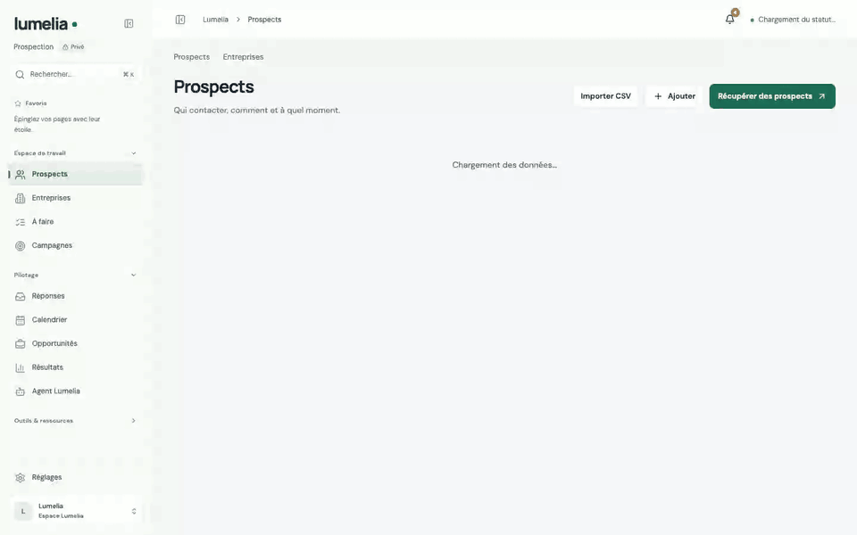
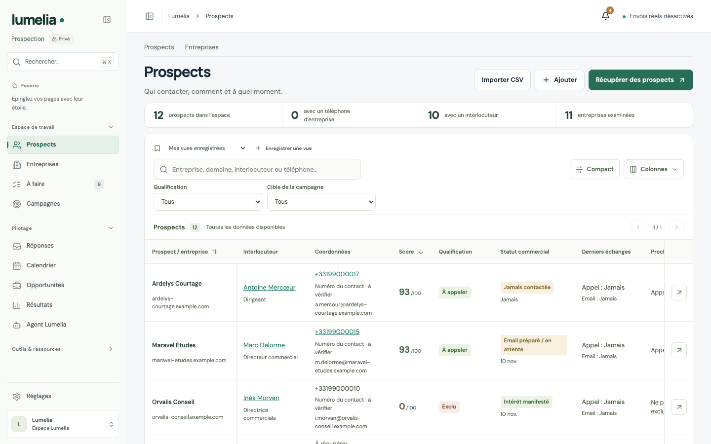
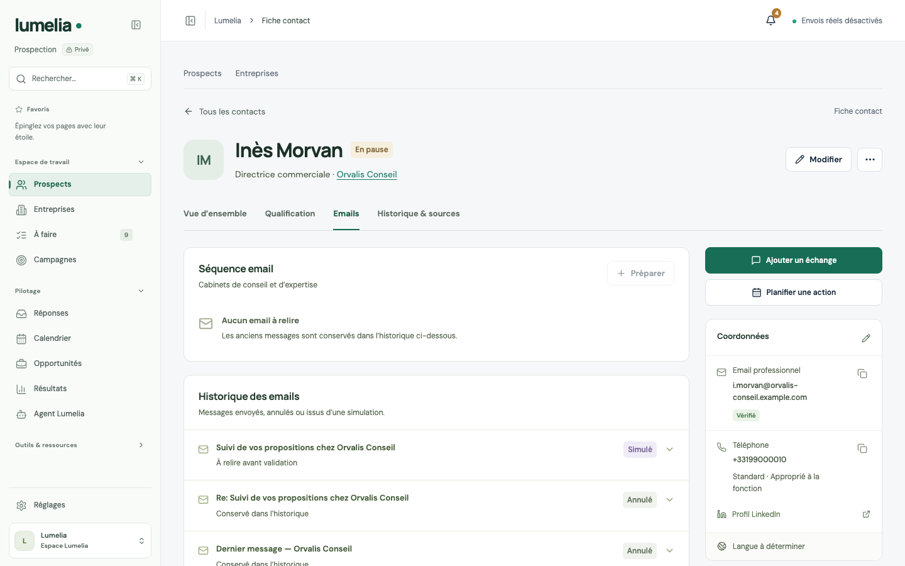
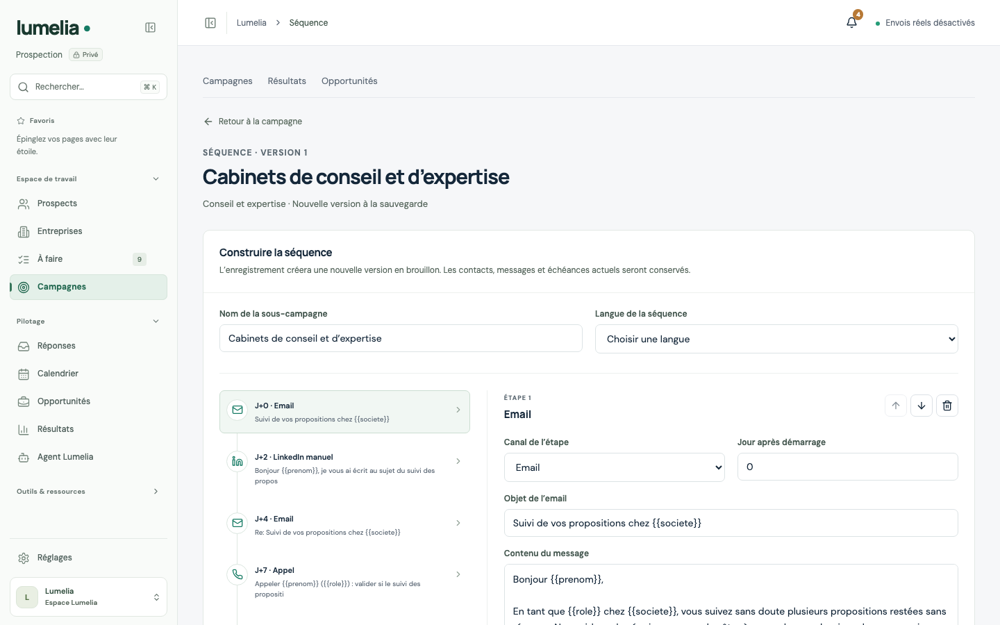
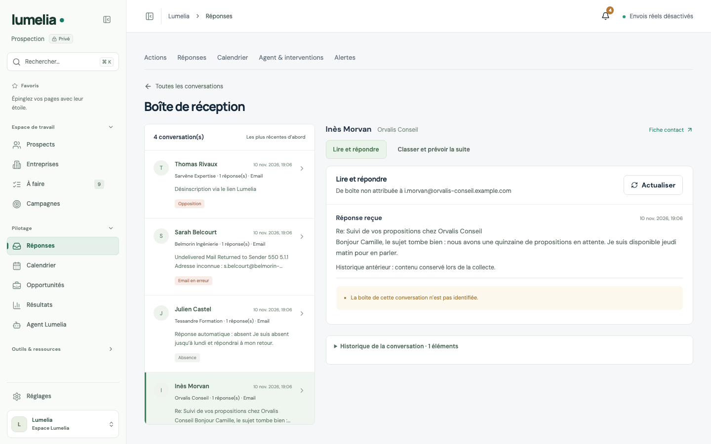
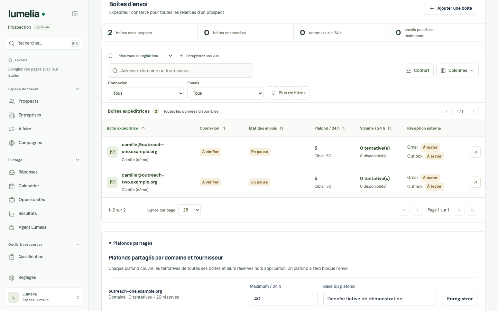
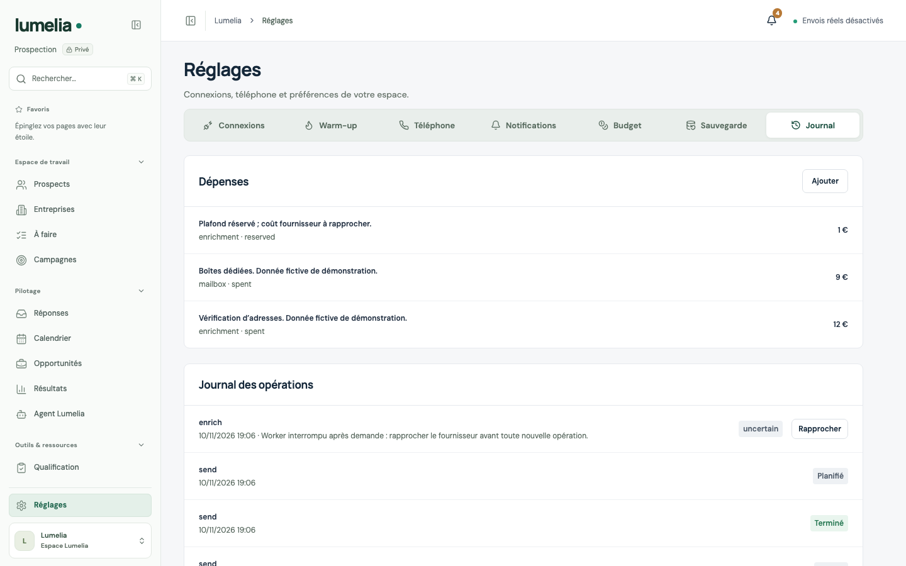
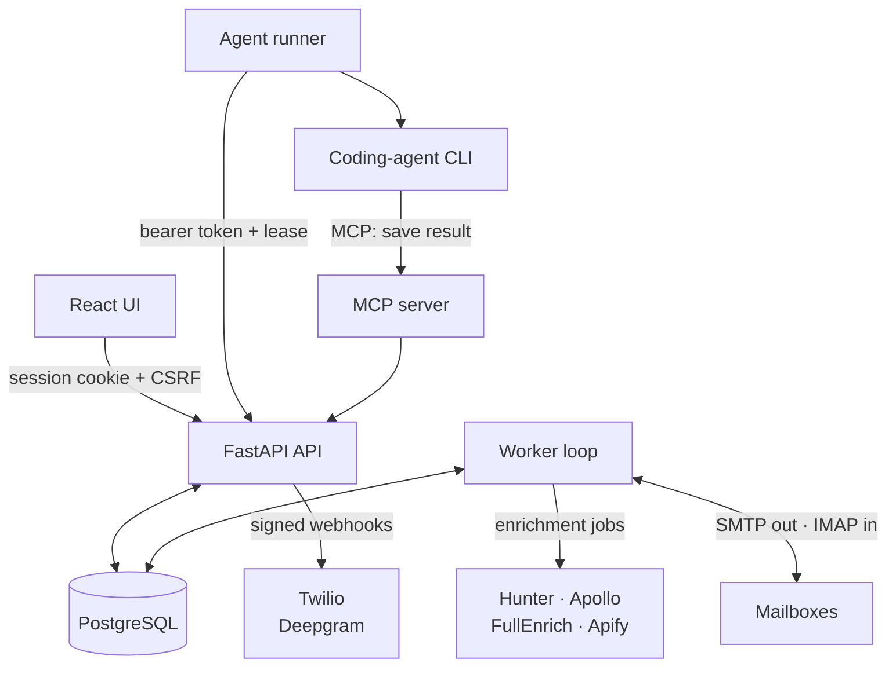
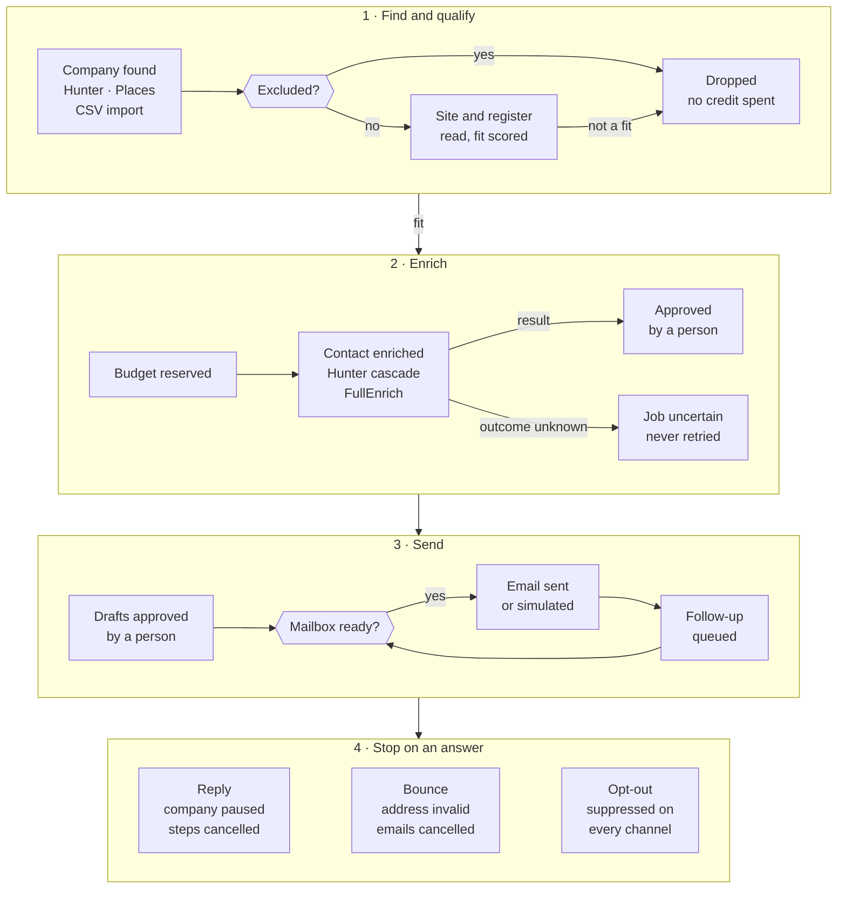

# Lumelia Outreach

[](https://github.com/bilLkarkariy/lumelia-outreach/actions/workflows/ci.yml)

A B2B outreach workspace: it finds companies, enriches contacts through a cascade of providers under
a reserved budget, runs email, call and LinkedIn sequences from your own mailboxes, and stops
following up as soon as someone answers. Originally built as Lumelia's internal outreach tool.

## Demo



Full video: [docs/demo/walkthrough.mp4](docs/demo/walkthrough.mp4) · shot-by-shot script:
[docs/DEMO.md](docs/DEMO.md). The interface is in French; the video has English captions.
Everything shown is invented demo data running in simulation mode.

| | |
| --- | --- |
|  Prospect pipeline: status and score per company |  Contact page: the sequence prepared for one person |
|  Sequence editor: email, call and LinkedIn steps |  Inbox: a reply and what it stopped |
|  Mailboxes: caps per mailbox, domain and mail provider |  Journal: a purchase left uncertain, with its reserved budget |

## Features

**Acquisition and enrichment** ([docs/ACQUISITION.md](docs/ACQUISITION.md))

- Enrichment cascade on Hunter: company discovery, then domain search, then address verification,
  each stage a job with its own guard. Adapters for FullEnrich (asynchronous bulk enrichment) and
  Apollo (people match and search).
- Deduplication and exclusions before any credit is spent: paused, suppressed, customer and
  protected-domain records are dropped when the job is picked and again right before the request.
- Idempotent purchase jobs: asking twice returns the first job.
- Company search on Google Places through an Apify actor, with per-run and monthly cost caps.
- CSV import with duplicate detection.

**Qualification** ([docs/PROSPECT_PIPELINE.md](docs/PROSPECT_PIPELINE.md))

- A prospect pipeline that reads each company's own site and the French company register, scores
  the fit out of 100 and keeps the source of every fact.
- Paid enrichment only for companies that passed qualification, highest score first.
- A contact is sendable only once a person approved it, with a documented role, a documented source
  and a recently verified address. One active contact per company.

**Sending** ([docs/SENDING.md](docs/SENDING.md))

- SMTP sending from several mailboxes, with daily caps per mailbox, per sending domain and per mail
  provider, a minimum interval between sends, and sending days and hours per campaign.
- Progressive ramp-up per mailbox: 5 emails a day at first, increases earned by healthy days and
  approved by a person, automatic reduction after an error or a bounce.
- Warm-up between the workspace's own mailboxes, over the same SMTP and IMAP path.
- Versioned sequences of email, call and LinkedIn steps. Call and LinkedIn steps become tasks.
- Simulation mode: the whole flow runs and is recorded without opening an SMTP connection.

**Replies**

- IMAP collection that matches replies to sent messages and tells replies, out-of-office notices
  and bounces apart. A reply pauses the contact and the company and cancels everything pending.
- One-click unsubscribe link in every email. An opt-out suppresses the contact on every channel.
- Contacts expire 365 days after creation.

**Calls** ([docs/PHONE_ROUTING.md](docs/PHONE_ROUTING.md))

- Browser calls, calls bridged through the operator's mobile, and inbound routing, with signed
  webhooks, encrypted recordings kept 30 days and transcription.

**Agent** ([docs/AGENT.md](docs/AGENT.md))

- A runner that hands research and drafting tasks to a headless coding-agent CLI, one process per
  task, under a lease and a token budget. Its MCP server lets the model save a result for the task
  it claimed and nothing else.

**Operations** ([docs/SECURITY_MODEL.md](docs/SECURITY_MODEL.md), [docs/BACKUP.md](docs/BACKUP.md))

- HttpOnly session cookie, CSRF token, Argon2 password hash, login throttling.
- Provider credentials, mailbox passwords and call audio encrypted with Fernet.
- Encrypted backup, and a restore that can only create a new database.

## Architecture



The API and the worker are the same image with two commands. PostgreSQL is the only store and the
only queue: jobs are rows claimed with `SELECT … FOR UPDATE SKIP LOCKED`. In production the API also
serves the compiled UI, so a deployment is one origin behind a TLS proxy.

The journey of a contact, from discovery to follow-up:



Exclusions cover customers, paused or suppressed records and protected domains. An uncertain job
waits for a person to reconcile it. A send that is not yet allowed (caps, ramp-up, sending window)
is postponed, not cancelled. Replies, out-of-office notices (handled like a reply) and bounces arrive
over IMAP; an opt-out comes from the unsubscribe link or from a reply a person classifies in the
inbox.

## Design decisions

**Budget is reserved before the call.** A paid request starts only after an expense row is reserved
against three ceilings: the campaign, the workspace month and the provider month. Concurrent jobs
cannot overspend together, and a refused reservation costs nothing.

**An uncertain operation is never retried automatically.** When a purchase or a send may or may not
have happened (timeout, crash between request and answer), the job becomes `uncertain` and waits for
a person. Retrying would risk paying twice or emailing someone twice; both are worse than a delay.

**Mailboxes have caps and a ramp-up.** Volume is limited per mailbox, per domain and per mail
provider, and a new mailbox earns its volume over days. A domain's reputation is shared and slow to
repair, so the tool makes the cautious path the default one.

**An opt-out stops everything.** One opt-out suppresses the contact and the address on email, phone
and LinkedIn, and cancels what was queued. Eligibility is checked again right before every send, so
nothing queued earlier slips through, and the unsubscribe link changes nothing on `GET`, so a mail
scanner cannot trigger it.

**Simulation is a first-class mode.** A campaign in simulation runs the real code path up to the
SMTP connection and records what would have been sent. Live actions additionally require a
server-side switch, so a sequence can be reviewed end to end before a single email exists.

## Run locally

### With Docker

```bash
docker compose up --build
```

Open <http://localhost:8080> and sign in with `demo-password-1234`. The stack starts PostgreSQL, the
API, the worker and a seed job that fills the workspace with invented companies, contacts, campaigns,
sequences and inbox answers. Campaigns are in simulation, live actions are off, and the application
containers sit on a network with no route to the outside. `docker compose down -v` removes the data.

### Without Docker

Requirements: Python 3.12 or later with [uv](https://docs.astral.sh/uv/), Node 22, PostgreSQL 17.

```bash
cp backend/.env.example backend/.env
# edit backend/.env: set LUMELIA_DATABASE_URL and LUMELIA_ENCRYPTION_KEY
(cd backend && uv sync && uv run python scripts/set_access_password.py)
./run-local.sh   # migrations, API, worker and Vite dev server
```

The interface is then on <http://127.0.0.1:5173>. To load the demo data into that database, run
`uv run python -m scripts.seed_demo` from `backend/` while the API is running, with
`LUMELIA_DEMO_PASSWORD` set to the password you chose.

## Tests and checks

The backend tests need a PostgreSQL database named `lumelia_test`:

```bash
docker run -d --name lumelia-testdb -e POSTGRES_USER=lumelia -e POSTGRES_DB=lumelia_test \
  -e POSTGRES_HOST_AUTH_METHOD=trust -p 127.0.0.1:55439:5432 postgres:17.7-alpine

uv run --project backend ruff check .
uv run --project backend ruff format --check .
(cd backend && uv run mypy && uv run pytest -q)
(cd frontend && npm ci && npm run lint && npm run format:check \
  && npm run typecheck && npm run build)
```

`LUMELIA_TEST_DATABASE_URL` points the tests at another database; the backup test also needs
`pg_dump` at least as recent as the server. The same commands run in CI
([.github/workflows/ci.yml](.github/workflows/ci.yml)).

## Repository layout

```
backend/
  app/            FastAPI app: domain rules, worker, providers, mail, calls, agent API
  migrations/     Alembic migrations
  scripts/        backup and restore, demo seed, password setup
  tests/          pytest suite (PostgreSQL)
frontend/
  src/            React UI (Vite, TypeScript)
  scripts/        Playwright script that captures the screenshots and the walkthrough
agent/            agent runner and its MCP server
docs/             technical notes, demo script, screenshots
compose.yaml      local demo stack
Dockerfile        single image for the API, the worker and one-off jobs
```

## Status

Built and deployed as Lumelia's internal tool; outbound campaigns were never launched. The hosted
instance has been shut down and this repository is a cleaned public copy of the code, without its
history or its data. The interface and the default templates are in French.

## License

[MIT](LICENSE)
